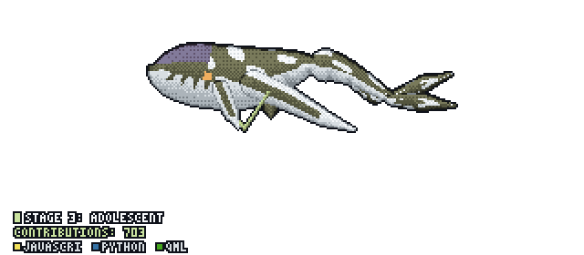

<picture>
  <source
    media="(prefers-color-scheme: light)"
    srcset="./output_card_light.svg?v=2"
  >
  <source
    media="(prefers-color-scheme: dark)"
    srcset="./output_card.svg?v=2"
  >
  
</picture>

 

  

